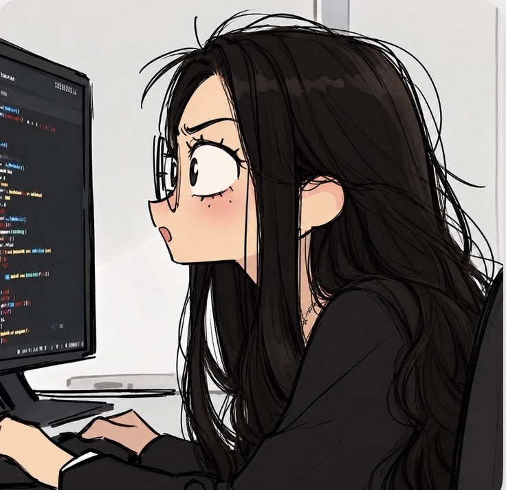

<!-- GitHub Profile README | polished purple edition -->

  

<table>
  <tr>
    <td width="66%" valign="middle">
      <h1>Hey, I'm Ella </h1>
      <h3>Creative mind. Developer mindset.</h3>
      

        I enjoy turning ideas into useful digital experiences — from clean, responsive interfaces to the logic that makes applications work.
      

      

        
        
      

    </td>
    <td width="34%" align="center" valign="middle">
      <!-- Upload your image into the assets folder, then change the filename below if needed. -->
      
    </td>
  </tr>
</table>

---

<h2 align="center">✦ A little about me</h2>

<table>
  <tr>
    <td width="50%" valign="top">
      <h3>👩‍💻 What I enjoy</h3>
      <ul>
        <li>Building web applications with JavaScript.</li>
        <li>Designing clean and responsive user interfaces.</li>
        <li>Exploring backend systems, APIs, and databases.</li>
        <li>Improving projects through testing and iteration.</li>
      </ul>
    </td>
    <td width="50%" valign="top">
      <h3>🎯 What I'm working toward</h3>
      <ul>
        <li>Becoming a stronger fullstack developer.</li>
        <li>Writing maintainable and reusable code.</li>
        <li>Understanding software architecture.</li>
        <li>Shipping practical, production-ready projects.</li>
      </ul>
    </td>
  </tr>
</table>

<h2 align="center">✦ Tech stack</h2>

<b>Currently working with</b>

  

<b>Currently learning</b>

  

---

<h2 align="center">✦ Selected projects</h2>

A few things I've been building, learning from, and improving.

<table>
  <tr>
    <td width="50%" valign="top">
      <h3>🌐 <a href="https://github.com/EllaUktolseja/elara">Elara</a></h3>
      
Personal developer portfolio built with React, JavaScript, and Vite.

      React · JavaScript · Vite
    </td>
    <td width="50%" valign="top">
      <h3>🍪 <a href="https://github.com/EllaUktolseja/rookees">Rookees</a></h3>
      
A lightweight website for an artisanal brownie-cookie business.

      HTML · CSS · JavaScript
    </td>
  </tr>
  <tr>
    <td width="50%" valign="top">
      <h3>🧩 <a href="https://github.com/EllaUktolseja/realla-web">Realla Web</a></h3>
      
A fullstack portfolio platform and an important learning milestone.

      React · Express · MongoDB
    </td>
    <td width="50%" valign="top">
      <h3>🔬 <a href="https://github.com/EllaUktolseja/Research">Research</a></h3>
      
Software security research exploring malicious npm package analysis.

      JavaScript · npm ecosystem · Security
    </td>
  </tr>
  <tr>
    <td colspan="2" valign="top">
      <h3>📰 <a href="https://github.com/EllaUktolseja/Veritas">Veritas</a></h3>
      
A web-based fake news detection project using NLP and machine learning.

      Web Development · NLP · Machine Learning
    </td>
  </tr>
</table>

---

<h2 align="center">✦ Current focus</h2>

  <h3>Building my fullstack foundation</h3>
  

    I'm rebuilding a fullstack e-commerce application as a hands-on learning project,
    focusing on <b>Next.js, NestJS, Prisma, and PostgreSQL</b>.
  

  

    The project is currently private while I work through the architecture and implementation.
  

  
  
  
  

---

<h2 align="center">✦ GitHub at a glance</h2>

<table>
  <tr>
    <td width="50%" align="center" valign="top">
      
    </td>
    <td width="50%" align="center" valign="top">
      
    </td>
  </tr>
</table>

  

  Statistics are generated by third-party services and reflect the public activity available to them.

---

  <h3>Thanks for stopping by!</h3>
  
<i>Stay curious, keep building, and make every commit count.</i>

  

